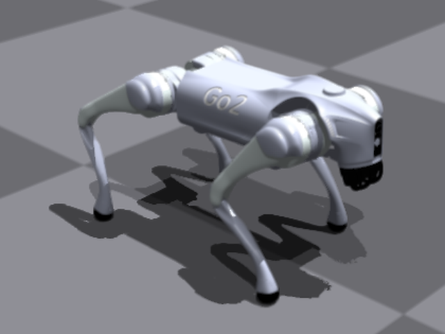
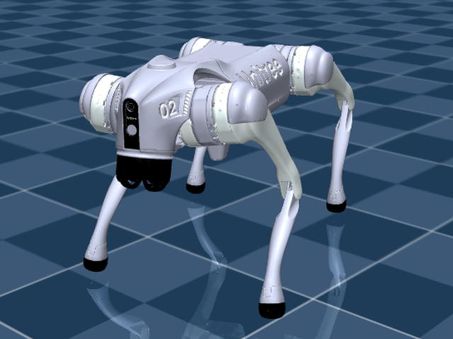
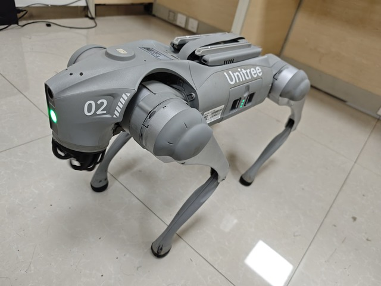

# Unitree Go2 RL Gym

面向 Unitree Go2 的强化学习运动控制项目，包含 Isaac Gym 训练、MuJoCo 仿真验证和基于 Unitree SDK2 / DDS 的真机部署工具。

项目使用同一套观测与动作接口，将训练得到的策略导出为 TorchScript，并用于仿真和实体机器人推理。键盘控制支持前进、后退、左右侧移、行进中转向和速度归零。

> 基于 [Unitree 官方 unitree_rl_gym](https://github.com/unitreerobotics/unitree_rl_gym) 开发，专注 Go2。本项目为独立开发项目，不代表 Unitree 官方实现或背书。

[环境安装](doc/setup_zh.md) · [真机部署](deploy/deploy_real/README_GO2.zh.md)

| Isaac Gym | MuJoCo | 真机 |
|:---:|:---:|:---:|
|  |  |  |

## 特性

- **可部署的训练结构**：45 维 Actor 使用 IMU、关节状态、速度指令和动作历史；60 维 Critic 在训练时使用额外的仿真信息。
- **一致的策略接口**：训练导出观测顺序、缩放、关节映射和控制参数，MuJoCo 与真机共用观测构造及动作转换。
- **完整的仿真路径**：支持 Python MuJoCo、官方 DDS 仿真闭环、速度指令和外力扰动测试。
- **受限真机控制**：提供站姿接管、键盘运动、速度归零、受控降低、阻尼停止及运行日志。

## 工作流程

```text
Isaac Gym / PPO
    │  导出 Actor + deploy.yaml
    ▼
TorchScript 策略
    ├── MuJoCo：运动与稳定性验证
    ├── DDS 仿真：通信与停止机制验证
    └── Go2：只读检查 → 站姿接管 → 受限运动
```

| 策略参数 | 配置 |
|---|---|
| Actor / Critic 输入 | 45 / 60 维 |
| 动作输出 | 12 个关节位置动作 |
| 策略周期 | 20 ms（50 Hz） |
| 动作缩放 | 0.25 |
| 策略 PD 增益 | Kp = 20，Kd = 0.5 |
| 预训练策略 | `deploy/pre_train/go2/motion.pt` |

Critic 仅用于训练。部署时，Actor 根据三维速度指令生成关节目标，由 PD 控制执行。

## 目录用途

| 目录 | 用途 |
|---|---|
| `legged_gym/` | Isaac Gym 训练、策略回放和导出 |
| `deploy/deploy_mujoco/` | 普通 MuJoCo 运行与键盘流程验证 |
| `deploy/deploy_real/` | 真机连接、控制和停止 |
| `deploy/common/` | 策略接口，以及保留供研究复用的速度反馈实现 |
| `tests/` | 自动检查代码、限制与停止逻辑；日常运行不需要打开 |
| `logs/` | 本地训练记录、实验数据和图表，不随 Git 上传 |

## 开始使用

```bash
git clone https://github.com/KehangWu-hub/unitree_rl_gym.git
cd unitree_rl_gym
export PYTHONPATH="$PWD${PYTHONPATH:+:$PYTHONPATH}"
```

依赖安装见[环境安装说明](doc/setup_zh.md)。下文统一使用 `unitree-rl` Conda 环境，训练、仿真和真机部署的依赖均安装在该环境中。训练需要 Isaac Gym、NVIDIA GPU 和 `rsl_rl`；MuJoCo 仿真需要 PyTorch、NumPy、PyYAML 和 MuJoCo，真机 DDS 通信另需 `unitree_sdk2py`。仅使用已有策略进行仿真或真机部署时，无需安装 Isaac Gym 和 `rsl_rl`。

仓库提供预训练策略和真机配置。安装部署依赖后，可先检查模型，无需连接机器人：

```bash
conda activate unitree-rl
python deploy/deploy_real/deploy_real_go2.py --check
```

### 训练与导出

安装训练依赖后运行：

```bash
conda activate unitree-rl
python legged_gym/scripts/train.py \
  --task go2 --headless --num_envs 4096 --max_iterations 1500 \
  --run_name go2_45x60_official_rewards
```

使用训练记录的实际目录名进行 Play 和导出：

```bash
python legged_gym/scripts/play.py \
  --task go2 --headless --load_run RUN_DIRECTORY --checkpoint 1500
```

默认导出目录：

```text
logs/rough_go2_45x60_rewards/exported/
├── policies/policy_1.pt
└── params/deploy.yaml
```

策略与 `deploy.yaml` 必须来自同一次导出。训练记录与导出目录不随 Git 分发；正式部署前应完成对应仿真验证。

### MuJoCo 仿真

默认仿真配置使用上面的导出文件。准备好策略与参数后运行：

```bash
conda activate unitree-rl
python deploy/deploy_mujoco/deploy_go2.py --command 0.5 0.0 0.0
```

`--command` 依次为前进速度、侧向速度和偏航角速度，单位为 m/s、m/s、rad/s。无窗口运行及扰动测试：

```bash
python deploy/deploy_mujoco/deploy_go2.py \
  --headless --no-realtime --duration 10 --command 0.5 0.0 0.0

python deploy/deploy_mujoco/deploy_go2.py \
  --headless --no-realtime --duration 10 --command 0.5 0.0 0.0 \
  --push-at 5 --push-duration 0.2 --push-force 50 0 0
```

程序输出位移、速度误差、机身高度、倾角和力矩等指标。模型路径与物理参数在 [MuJoCo 配置](deploy/deploy_mujoco/configs/go2.yaml) 中设置，也可通过 `--policy` 和 `--deploy-config` 指定成套导出文件。

速度统计由上述仿真入口直接输出：`mean_body_velocity` 为机身坐标系平均速度，`velocity_error_xy` 为线速度误差。保留的 PI 补偿实现及参数见[速度观测与补偿说明](doc/velocity_tracking.md)；普通仿真入口不会自动启用这些补偿。

### 真机部署

真机控制使用 `go2_keyboard`，默认统一接收 Q/W/E/A/S/D，X 将速度归零，也保留单方向检查模式。从原厂站稳接管后，统一模式默认持续运行，C 受控降低并退出，Z/Ctrl+C 或第二终端停止紧急阻尼退出；可用 `--motion-seconds 4` 或 `10` 选择自动归零和降低的短时检查。运动入口默认对合法动作做步长限幅，`--walk-speed 0.5` 可将 W 纯前进指令从默认 0.30m/s 调整为 0.50m/s。

部署需要匹配当前模型与配置的站立、零速度前置记录；这些记录保存在本机，克隆仓库后需自行完成检查。连接、前置流程、运行命令及停止方法见 **[Go2 真机部署指南](deploy/deploy_real/README_GO2.zh.md)**。

已激活 `unitree-rl` 环境且机器人原厂站稳时，运行：

```bash
python -m deploy.deploy_real.go2_keyboard --walk-speed 0.5 --run
```

| 按键 | 功能 |
|---|---|
| W / S | 前进 / 后退 |
| A / D | 左移 / 右移 |
| Q / E | 行进中左转 / 右转 |
| X / 空格 | 停步，保持策略运行，可继续运动 |
| C | 正常趴下并退出：归零 2 秒、降低 5 秒、稳定 2 秒、阻尼收尾 1 秒 |
| Z / Ctrl+C | 紧急终止，立即进入阻尼并退出 |

C 用于默认持续模式，按一次即可；退出过程中仍可按 Z 紧急终止。可选短时检查自动降低，方向切换无需先按 X。

## 测试

```bash
conda activate unitree-rl
python -m unittest discover -s tests -p 'test_go2*.py'
```

测试覆盖策略接口、模型与关节映射、状态机、保护逻辑、键盘输入和看门狗。默认跳过需要本地 DDS 网络的集成测试。启用 MuJoCo / DDS 停止机制测试：

```bash
GO2_DDS_TESTS=1 python -m unittest discover -s tests -p test_go2_watchdog.py -v
```

## 项目结构

```text
legged_gym/                 Isaac Gym 环境、训练和策略导出
  envs/go2/                Go2 配置与观测定义
deploy/
  common/                  共用策略接口
  deploy_mujoco/           MuJoCo 运行与诊断
  deploy_real/             DDS 通信、真机控制与日志
  pre_train/go2/           冻结 TorchScript 模型
resources/robots/go2/      URDF、MJCF 与模型资产
tests/                     Go2 软件与集成测试
doc/                       安装与技术文档
```

## 来源与许可证

本项目建立在 [unitree_rl_gym](https://github.com/unitreerobotics/unitree_rl_gym)、[legged_gym](https://github.com/leggedrobotics/legged_gym)、[rsl_rl](https://github.com/leggedrobotics/rsl_rl)、[MuJoCo](https://github.com/google-deepmind/mujoco)、[unitree_mujoco](https://github.com/unitreerobotics/unitree_mujoco) 和 [unitree_sdk2_python](https://github.com/unitreerobotics/unitree_sdk2_python) 之上。

本仓库采用 [BSD 3-Clause License](LICENSE)。第三方代码及资产遵循各自的许可证。
