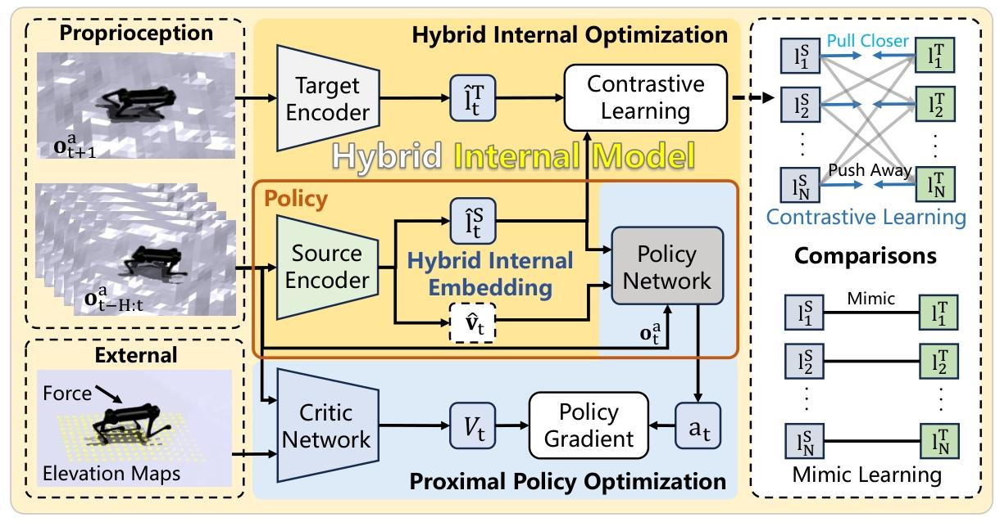

# Unitree Go2 RL Gym

面向 Unitree Go2 的强化学习运动控制项目，覆盖 **Isaac Gym训练 → MuJoCo仿真 → 真机键盘控制**。支持PPO和HIM两种策略，训练导出的模型与接口参数用于仿真和真机部署。

[安装](doc/setup_zh.md) · [HIM训练与部署](deploy/deploy_real/README_GO2_HIM.zh.md) · [PPO真机控制](deploy/deploy_real/README_GO2.zh.md) · [模型接口](deploy/pre_train/go2_him/README.md)

| Isaac Gym | MuJoCo | Go2真机 |
|:---:|:---:|:---:|
|  |  |  |

## 项目能力

- **策略训练**：PPO、HIM，支持平地和混合地形、域随机化与断点续训。
- **HIM状态估计**：根据六帧本体观测估计3维速度和16维隐变量，与当前观测共同输入Actor。
- **统一部署接口**：TorchScript模型配套导出观测顺序、缩放、关节映射和控制参数。
- **仿真评估**：支持速度跟踪、停步、扰动及脚端净空、接触滑移等指标。
- **真机控制**：SDK2 / DDS通信，支持键盘行走、受控降低、阻尼停止和运行日志。

## HIM结构



部署模型包含历史编码器与Actor；Critic、Target Encoder和对比学习用于训练。

| 接口 | PPO | HIM |
|---|---:|---:|
| 部署模型输入 | 45维 | 270维（6×45） |
| Actor输入 | 45维 | 64维（45＋3＋16） |
| Critic输入，仅训练 | 60维 | 238维 |
| 动作输出 | 12维 | 12维 |
| 本项目部署策略周期 | 20ms | 20ms |
| 动作缩放 | 0.25 | 0.25 |
| 策略PD增益 | 20 / 0.5 | 20 / 0.5 |

## 快速开始

完成[环境安装](doc/setup_zh.md)后，从仓库根目录运行：

```bash
conda activate unitree-rl
export PYTHONPATH="$PWD${PYTHONPATH:+:$PYTHONPATH}"
```

### 运行HIM仿真

使用仓库内的配套模型和参数：

```bash
python -m deploy.deploy_mujoco.deploy_go2 \
  --config deploy/deploy_mujoco/configs/go2_him_fresh.yaml \
  --command 0.3 0 0
```

添加 `--headless --no-realtime --duration 10` 可运行无窗口仿真。`--command`依次为前进速度、侧向速度和偏航角速度，单位为m/s、m/s、rad/s。

### 训练HIM

```bash
python legged_gym/scripts/train_him_from_scratch.py \
  --profile candidate-rough --run-dir logs/him/my_run \
  --headless --num_envs 1024 --max_iterations 3000 --seed 42
```

`candidate-rough`使用混合地形；`candidate-flat`使用匹配的平地配置。训练记录和导出文件写入指定的运行目录。其他训练入口、续训和权重替换见[HIM指南](deploy/deploy_real/README_GO2_HIM.zh.md)。

### 真机键盘控制

从原厂站姿接管，具体连接与启动命令见[HIM指南](deploy/deploy_real/README_GO2_HIM.zh.md#真机键盘控制)或[PPO指南](deploy/deploy_real/README_GO2.zh.md)。

| 按键 | 功能 |
|---|---|
| W / S | 前进 / 后退 |
| A / D | 左移 / 右移 |
| Q / E | 前进并左转 / 右转 |
| X / 空格 | 速度归零 |
| C | 受控降低并退出 |
| Z / Ctrl+C | 阻尼停止并退出 |

HIM默认平移指令为0.30m/s，PPO统一模式前后为0.50m/s、侧移为0.40m/s；指令速度与实际速度分别记录。

## 项目结构

```text
legged_gym/          Go2环境、任务配置、训练与导出
third_party/         固定版本的HIM算法与网络实现
deploy/
  common/            策略接口、速度估计与反馈控制
  deploy_mujoco/     MuJoCo运行、步态测量与评估
  deploy_real/       DDS通信、控制状态机与键盘入口
  pre_train/         部署模型、接口参数与版本记录
resources/           URDF、MJCF与模型资产
tests/               训练、仿真和控制逻辑测试
doc/                 安装说明与项目图片
logs/                本地训练及运行产物，不随Git分发
```

## 开发

```bash
make test       # 离线回归，关闭可选DDS集成测试
make check      # 补丁格式检查
make clean      # 清除源码目录的Python缓存
```

可用 `make test PYTHON=/path/to/python` 指定解释器。

本项目基于 [unitree_rl_gym](https://github.com/unitreerobotics/unitree_rl_gym) 和 [HIMLoco](https://github.com/InternRobotics/HIMLoco) 等开源实现开发，许可证见 [LICENSE](LICENSE)。
