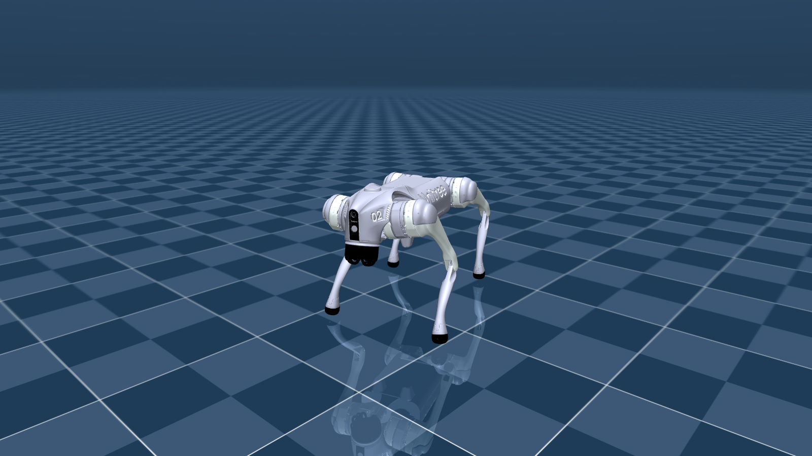

<div align="center">
  <h1>Unitree Go2 RL Gym</h1>
  <p><strong>面向 Unitree Go2 的强化学习训练、MuJoCo 验证与真机部署验证。</strong></p>
</div>



> [!IMPORTANT]
> 本项目基于 Unitree 官方
> [unitree_rl_gym](https://github.com/unitreerobotics/unitree_rl_gym)
> 开发，但不是 Unitree 官方项目，也不代表 Unitree Robotics 的官方实现或背书。
> 本 README 只介绍本项目的 Go2 工作。

## 项目概览

本项目打通了以下 Go2 部署链路：

```text
Isaac Gym 训练
  → Isaac Gym Play 与策略导出
  → Python MuJoCo Sim2Sim
  → Unitree SDK2 / DDS 官方 MuJoCo 闭环
  → 实体 Go2 有线只读连接与策略影子检查（已完成）
  → 实体电机控制、站姿接管、零速及首次短时迈步/停走（已记录）→ 扩展真机验证（待完成）
```

当前正式策略采用：

- 45 维 Actor：机身角速度、投影重力、速度指令、关节位置、关节速度和上一帧动作；
- 60 维 Critic：仅训练时额外使用机身线速度和关节力矩等特权信息；
- 12 维动作：对应 Go2 的 12 个驱动关节；
- 50 Hz 策略频率：控制周期为 0.02 秒；
- PD 参数：Policy 阶段 `Kp=20`、`Kd=0.5`。

Actor 只依赖真机可获得的信息。Critic 不会进入导出的 TorchScript，也不会用于 MuJoCo 或真机推理。

## 已完成内容

- Go2 45/60 非对称 Actor-Critic 训练环境与官方关键奖励适配；
- 1500 轮正式训练、Isaac Gym Play 和 checkpoint/TorchScript 一致性验证；
- Actor 与 `deploy.yaml` 成套导出，固化观测、动作、PD 参数和关节映射；
- Unitree 官方 Go2 MJCF 资产接入及专用 Python MuJoCo 运行器；
- 平地六方向、长时运行、组合指令和外力扰动 Sim2Sim 验收；
- Go2 真机侧四态 FSM：`Passive → FixStand → Policy / Damping`；
- LowState、LowCmd、CRC、DDS、键盘速度输入和策略/SDK 关节顺序转换；
- 通信、姿态、关节、动作变化、目标角和估算力矩安全检查；
- 官方 `unitree_mujoco + unitree_sdk2py + DDS` 前进与组合指令闭环；
- 键盘前进、`X`/空格归零后的站立保持，在动态DDS/MuJoCo中通过；
- 独立看门狗、第二终端停止及受限单关节测试；六种动态DDS/MuJoCo场景通过；
- 实体 Go2 EDU 有线只读连接，以及 12 秒真机状态驱动的策略影子检查；
- Go2软件测试，以及原看门狗六种场景和验收入口的本机DDS集成测试；新增无策略站立流程验证进度见真机指南。

影子检查没有创建 LowCmd 发布器，也没有向电机发送指令。2026-10-09另完成趴卧真机零Kp阻尼、独立停止请求及原厂模式恢复检查；12关节受限测试均有估算力矩响应，9项通过角度判据，右前髋及两前小腿角度响应不足。随后完成14秒站姿接管/保持/降低及2秒零速度策略真机试跑，日志未触发保护；现场已确认零速试跑稳定、无异常；首次0.30m/s短时迈步与停走已现场确认；长时行走与完整断链停机仍未验证。

## 关键目录

本仓库仅支持 Go2，包含其训练环境、URDF/MJCF、策略和部署配置。公共训练框架及许可证保留；上游其他机器人示例可从 [宇树官方仓库](https://github.com/unitreerobotics/unitree_rl_gym) 获取。

```text
legged_gym/envs/go2/                 Go2 训练配置与45/60维观测
legged_gym/scripts/train.py          Isaac Gym训练入口
legged_gym/scripts/play.py           Play、Actor与部署契约导出
legged_gym/utils/deploy.py           deploy.yaml导出
deploy/common/go2_policy.py          MuJoCo与Real共用的观测/动作接口
deploy/deploy_mujoco/deploy_go2.py   Go2专用Python MuJoCo运行器
deploy/deploy_mujoco/configs/go2.yaml
deploy/deploy_real/deploy_real_go2.py
deploy/deploy_real/go2_watchdog.py    DDS仿真独立指令看门狗与停止入口
deploy/deploy_real/go2_commission.py  真机阻尼、逐关节、站姿接管与限时策略入口
deploy/deploy_real/configs/go2.yaml
deploy/pre_train/go2/motion.pt       冻结的正式TorchScript Actor
resources/robots/go2/mjcf/           官方Go2 MJCF及场景资产
tests/test_go2*.py                   Go2回归测试
```

## 环境准备

基础依赖与 Isaac Gym 安装方式见 [中文安装说明](doc/setup_zh.md)。本项目当前使用两个环境：

- `LeggedGym`：Isaac Gym 训练与 Play；
- `unitree-rl`：MuJoCo、自动测试及 Unitree SDK2/DDS 部署。

进入项目目录：

```bash
cd /home/wkh/projects/unitree_rl_gym
```

## 1. Isaac Gym 训练

激活训练环境：

```bash
source /home/wkh/anaconda3/etc/profile.d/conda.sh
conda activate LeggedGym
export PYTHONPATH="$PWD${PYTHONPATH:+:$PYTHONPATH}"
```

在项目根目录设置 `PYTHONPATH`，确保训练与 Play 加载本仓库，避免导入环境中另一个已安装的 `legged_gym`。

正式训练前建议先运行小规模契约检查：

```bash
python legged_gym/scripts/train.py \
  --task=go2 --headless \
  --num_envs=64 --max_iterations=2 \
  --run_name=contract_check
```

网络打印应显示 Actor 输入 45 维、Critic 输入 60 维，且训练过程没有 NaN、Inf 或维度错误。

正式训练：

```bash
python legged_gym/scripts/train.py \
  --task=go2 --headless \
  --num_envs=4096 --max_iterations=1500 \
  --run_name=go2_45x60_official_rewards
```

checkpoint 默认保存到：

```text
logs/rough_go2_45x60_rewards/<时间>_<run名称>/model_<迭代数>.pt
```

## 2. Play 与导出

指定正式 run 和 checkpoint：

```bash
python legged_gym/scripts/play.py \
  --task=go2 --headless \
  --load_run=<实际run目录名> \
  --checkpoint=1500
```

Play 会成套导出：

```text
logs/rough_go2_45x60_rewards/exported/policies/policy_1.pt
logs/rough_go2_45x60_rewards/exported/params/deploy.yaml
```

`policy_1.pt` 与 `deploy.yaml` 必须配套使用，不能混用不同训练 run 的策略和参数。

## 3. Go2 MuJoCo Sim2Sim

激活部署环境：

```bash
source /home/wkh/anaconda3/etc/profile.d/conda.sh
conda activate unitree-rl
```

打开 MuJoCo 窗口并发送前进指令：

```bash
python deploy/deploy_mujoco/deploy_go2.py --command 0.5 0.0 0.0
```

指令顺序为 `前进速度 侧向速度 偏航角速度`。例如：

```bash
# 静止站立
python deploy/deploy_mujoco/deploy_go2.py --command 0.0 0.0 0.0

# 左移
python deploy/deploy_mujoco/deploy_go2.py --command 0.0 0.3 0.0

# 左转
python deploy/deploy_mujoco/deploy_go2.py --command 0.0 0.0 0.5

# 前进、左移并右转
python deploy/deploy_mujoco/deploy_go2.py --command 0.5 0.2 -0.3
```

无窗口快速验收：

```bash
python deploy/deploy_mujoco/deploy_go2.py \
  --headless --no-realtime --duration 10 \
  --command 0.5 0.0 0.0
```

外力扰动测试：

```bash
python deploy/deploy_mujoco/deploy_go2.py \
  --headless --no-realtime --duration 10 \
  --command 0.5 0.0 0.0 \
  --push-at 5 --push-duration 0.2 --push-force 50 0 0
```

运行结束会输出 JSON 指标，包括跌倒状态、有限值检查、机身高度、最大倾角、最大力矩、位移和速度。

## 4. 自动测试

```bash
conda activate unitree-rl
python -m unittest discover -s tests -p 'test_go2*.py'
```

软件测试覆盖训练契约、45维策略接口、MJCF、关节映射、FSM、控制器、只读影子模式、键盘输入超时、受限测试和看门狗锁存。默认跳过需要本地DDS网络的集成测试；最近实际运行结果见[工作日志](.codex/Doc.md)。

自动启动测试用MuJoCo/DDS桥接并验证六种故障场景，无需连接机器人或另装 `unitree_mujoco`：

```bash
GO2_DDS_TESTS=1 python -m unittest discover -s tests -p test_go2_watchdog.py -v
```

## 5. Unitree SDK2 / DDS 部署

详细步骤见 [Go2 真机部署指南](deploy/deploy_real/README_GO2.zh.md)。实体机器人可能造成设备损坏或人身伤害；真机电机指令目前已被程序启动检查阻止。

只检查 Real 配置和冻结模型，不初始化 DDS：

```bash
python deploy/deploy_real/deploy_real_go2.py --check
```

官方 MuJoCo DDS 闭环使用本机回环网卡和非零 domain：

```bash
python deploy/deploy_real/deploy_real_go2.py lo \
  --domain-id 1 \
  --simulation-auto \
  --duration 12 \
  --command 0.3 0.0 0.0
```

`--simulation-auto` 被限制为 `lo + 非零 domain`，不能用于实体机器人。

实体 Go2 已完成有线只读连接。复现只读检查：

```bash
python deploy/deploy_real/deploy_real_go2.py <有线网卡> --read-only
```

使用真实状态计算策略目标但不下发：

```bash
python deploy/deploy_real/deploy_real_go2.py <有线网卡> \
  --read-only --shadow-policy --duration 12
```

2026 年 9 月 29 日的记录为 601 帧，其中 351 帧进入 `Policy`；数值均有限，没有软件安全故障，也没有创建 LowCmd 发布器。运行记录保存在本机 `logs/go2_real/`，不会随 Git 提交。

后续分级验收顺序：

```text
只读LowState
→ 策略只推理、不下发
→ 键盘速度输入与零速停走的动态DDS仿真（已通过）
→ 独立停机与受限电机控制的仿真验证（已通过）
→ 真机受限电机控制与停机验证
→ FixStand与落地站立
→ 微速运动与停止
→ 组合指令、扰动和长时运行
```

策略接收三维速度目标，再输出 12 个关节动作。键盘速度输入已接入只读影子模式和 DDS 仿真；停止输入 0.25 秒后速度目标归零。动态MuJoCo验证了`X`和空格归零后继续站立。`Z`或退出程序会转入阻尼，仿真机器人随后降低机身。手机 App 的虚拟摇杆是否可供底层程序读取仍待核对；常规键盘策略入口继续禁止真机主动下发；独立入口已完成2秒零速度策略试跑。键盘用法见 [Go2 真机部署指南](deploy/deploy_real/README_GO2.zh.md)。

2026-10-09实体站立状态下，12秒只读策略检查通过；另有16秒键盘影子检查通过，六方向输入、`X`/空格归零和输入超时归零均有日志记录。趴卧状态的小腿角度超出策略配置范围，策略拒绝启动；没有放宽策略限位。

随后完成一次3秒趴卧实体正负目标响应诊断：FL_hip估算力矩相对基线变化约+0.074Nm与-0.099Nm，达到预设响应判据；角度变化仍低于判据，实体方向与运动跟踪尚未确认。该轮后恢复了原厂模式与App；后续已完成站姿接管与首次限时策略，见下段。

实体电机验收使用独立的`go2_commission`入口：阻尼和单关节模式不站起；`--stand-check --start-standing`完成14秒无策略接管/保持/降低；`--policy-check READY_JSONL`通过保持判据后运行2秒零速度策略，再自动降低与阻尼。新增`--forward-check ZERO_JSONL`为固定2秒低速前进及归零候选；首次候选因零速接管反馈力矩超限停止；修复接管时序并增加10.5Nm输出限幅后，零速复核及0.10m/s指令流程通过，但现场没有迈步。随后完成0.30m/s限时真机试跑：现场确认向前迈步、归零后停止并趴卧，无异常。总控制时长日志判据存在接管计时偏差，已修复软件，未重复真机。`--joint-check`固定0.02弧度、Kp40，一次只有所选关节正Kp，12关节已采集。原厂模式退出、第二终端停止、分析判据与恢复流程见上述指南，实际记录见[工作日志](.codex/Doc.md)。

DDS仿真主动控制由独立看门狗进程发布LowCmd；主控制程序冻结或被强制结束后，命令超过100毫秒未更新会锁存停止。另一终端可运行 `python -m deploy.deploy_real.go2_watchdog --stop --domain-id 1` 请求阻尼。该措施仍依赖电脑、看门狗进程和通信，尚未验证真机效果。

六种场景的测试条件与实测延迟见 [独立停机仿真记录](.codex/Doc.md#2026-09-30-受限电机测试与独立停机)。

任何阶段出现通信超时、姿态异常、关节撞限位、异常声响或安全降级，都应立即停止升级测试并检查 `logs/go2_real/*.jsonl`，不能通过放宽安全阈值掩盖问题。

## 已知限制

- 策略实现的是近似速度跟踪，不是精确速度伺服；侧移和转向仍存在幅值欠跟踪。
- Isaac Gym 使用 URDF，MuJoCo 使用 MJCF，两者在接触、惯量、碰撞体和求解器上存在差异。
- 当前运动稳定性结论来自 Isaac Gym、Python MuJoCo 和官方 DDS/MuJoCo；实体 Go2 已完成12关节受限采集、站姿接管与2秒零速度策略试跑；首次0.30m/s短时迈步与停走已有现场证据；实体映射独立观察、方向组合和长时运行仍待验证。
- 修改观测顺序、缩放、关节映射、动作缩放、PD 参数或控制周期后，必须重新执行对应训练与部署验收。

## 致谢与来源

本项目建立在以下开源项目之上：

- [unitree_rl_gym](https://github.com/unitreerobotics/unitree_rl_gym)：项目上游与 Isaac Gym 训练框架；
- [legged_gym](https://github.com/leggedrobotics/legged_gym)：腿式机器人训练环境；
- [rsl_rl](https://github.com/leggedrobotics/rsl_rl)：PPO 实现；
- [MuJoCo](https://github.com/google-deepmind/mujoco)：Sim2Sim 物理仿真；
- [unitree_mujoco](https://github.com/unitreerobotics/unitree_mujoco)：Go2 MJCF 与官方 DDS 仿真链路；
- [unitree_sdk2_python](https://github.com/unitreerobotics/unitree_sdk2_python)：Go2 DDS 通信接口。

上游保留代码及资产继续遵循各自的版权与许可证条款。

## 许可证

本仓库按 [BSD 3-Clause License](LICENSE) 授权。使用和分发时请同时遵守仓库内第三方组件与资产的许可证要求。
